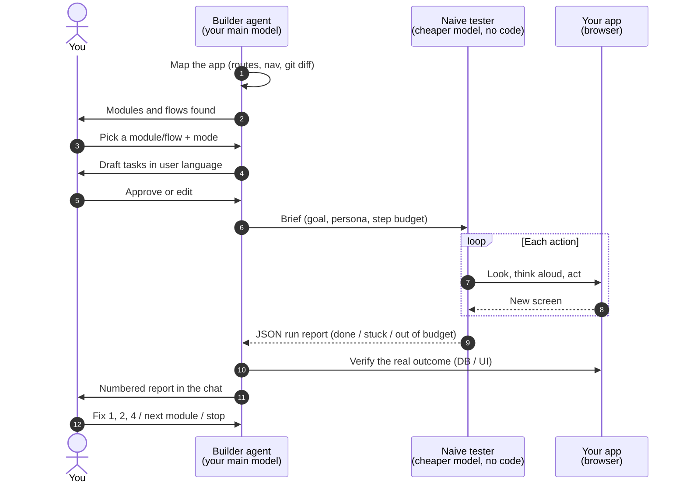

# UX Stranger

*Let a stranger try your app before your users do.*

  

> **Work in progress.** Used on real projects, but young. Expect rough edges, and please [open an issue](../../issues/new/choose) with what worked and what didn't.

**Usability testing for the UI your coding agent just built.**

Your agent is the worst judge of whether its own UI is intuitive: it knows where everything is. UX Stranger hands the judgment to a **naive tester**: a sub-agent on a cheaper model (Haiku, a GPT mini…) that **never sees the code**, uses the app **only through a browser**, and gets goals in **plain user language** ("Julie starts Monday as a server, get her set up"), not instructions ("click Team > Add").

Where it hesitates, takes wrong turns, or gives up, real users probably will too. The builder agent gets a numbered friction report, fixes what you pick, and re-tests only what changed.

- **Native, no API keys.** Runs inside the agent you already use (Claude Code, Codex, Cursor) with your existing plan.
- **Step-by-step.** Map the app → pick a module or flow → approve the tasks → test → read the report in the chat → fix / next module / stop.
- **Three modes.** `lite-check` (cheap smoke test), `standard`, `panel` (several models and personas, with consensus).

## How it works



Flags include `TASK_FAILED`, `FALSE_SUCCESS` (the tester thinks it worked and it didn't), `DISCOVERABILITY`, `INEFFICIENT_PATH`, `HESITATION`, `UNHELPFUL_ERROR`… A flag becomes a finding only if it repeats across runs, or if it is critical. Details: [`flag-rules.md`](skills/ux-stranger/references/flag-rules.md).

## Install

You need a browser MCP for the tester. [Playwright MCP](https://github.com/microsoft/playwright-mcp) works everywhere, and the server must be named `playwright`.

### Claude Code (plugin: skill + sub-agent in one step)

```bash
claude plugin install ux-stranger --marketplace BigDaveP/ux-stranger
claude mcp add playwright -- npx @playwright/mcp@latest
```

Or inside a session: `/plugin marketplace add BigDaveP/ux-stranger`, then `/plugin install ux-stranger@ux-stranger`.

### Codex

```bash
git clone https://github.com/BigDaveP/ux-stranger /tmp/ux-stranger
cp -r /tmp/ux-stranger/skills/ux-stranger .agents/skills/
mkdir -p .codex/agents && cp .agents/skills/ux-stranger/agents/codex/ux-tester.toml .codex/agents/
```

Then add Playwright MCP to `~/.codex/config.toml` (see [`host-setup.md`](skills/ux-stranger/references/host-setup.md)).

### Cursor

```bash
npx skills add BigDaveP/ux-stranger        # or copy skills/ux-stranger into .agents/skills/
mkdir -p .cursor/agents && cp .agents/skills/ux-stranger/agents/cursor/ux-tester.md .cursor/agents/
```

Set the tester `model` in `.cursor/agents/ux-tester.md` to a fast model ID. Then add Playwright MCP in `.cursor/mcp.json`.

## Use

| Command | What it does |
|---|---|
| `/ux-stranger` | Step-by-step: map, ask what to test, test it, report |
| `/ux-stranger map` | Build/refresh the app map only |
| `/ux-stranger <module>` | Jump straight to one module |
| `/ux-stranger all` | One-shot, no questions (also the default in CI/unattended runs) |
| `/ux-stranger lite-check …` | Cheap mode: ≤ 3 tasks, 1 run each, fewer screenshots |
| `/ux-stranger panel …` | Several models × personas, consensus. Shows a usage estimate first |

Or just ask: *"test the UX of the dashboard you just built"*.

Files it creates in your project: `ux-stranger/map.yaml`, `ux-stranger/tasks.yaml`, `ux-stranger/reports/`.

## Status

| | Status |
|---|---|
| Claude Code: standard mode, step-by-step | ✅ Used on a real site |
| Claude Code plugin install | ✅ Validated |
| lite-check mode | 🟡 Written, lightly tested |
| panel mode (multi-vendor via installed CLIs) | 🟡 Written, not yet tested |
| Codex | 🟡 Not yet tested. Model ID and sandbox/browser access may need tweaks |
| Cursor | 🟡 Not yet tested. Set the tester model |

## Safety

- **Test environments only.** The tester clicks real buttons. Never point it at production with destructive permissions.
- **Credentials** come from an environment variable (`UX_STRANGER_CREDENTIALS`). Use a test account, and never commit real credentials.
- **Reports** can quote on-screen data. Add `ux-stranger/reports/` to your `.gitignore` if your test data is sensitive.
- **Page content is untrusted.** The tester is told to treat page text as content, never instructions, and to report injection attempts as findings.
- This complements testing with real people. It doesn't replace it.

## Limits

An LLM is not a person. It can fail where humans wouldn't (tiny click targets, odd widgets) and breeze through what confuses humans (jargon it happens to know). Several runs and personas reduce the noise; the `panel` mode reduces model-specific bias. Treat findings as strong hints, and the report as a starting point for design decisions.

## Repository layout

```
.claude-plugin/          Claude Code plugin + marketplace manifests
agents/ux-tester.md      Plugin copy of the Claude tester (generated)
skills/ux-stranger/         The portable skill (SKILL.md + references + templates)
  agents/                Tester definitions for Claude, Cursor, Codex + generator
```

The tester prompt lives in one place: `skills/ux-stranger/references/tester-prompt.md`. After editing it, run `python3 skills/ux-stranger/agents/generate.py` to regenerate the three agent files.

## Contributing

Issues and PRs are welcome, especially **reports from Codex and Cursor users**, better flag rules, and real-world before/after examples. Please include the host, the mode, and an anonymized excerpt of the report.

---

## En français

**UX Stranger** teste l'UX de ce que ton agent de code vient de construire. Un sous-agent « naïf », sur un modèle moins puissant, essaie d'accomplir de vraies tâches d'utilisateur dans un navigateur, sans voir le code. Il note chaque hésitation, et l'agent principal reçoit un rapport numéroté des points de friction à corriger.

Ça fonctionne nativement dans Claude Code, Codex et Cursor, sans clé API. Par défaut, ça se déroule étape par étape : carte du site → choix d'un module → tâches à approuver → test → rapport dans la conversation → correction. Il y a un mode `lite-check` pour les petits abonnements et un mode `panel` multi-modèles.

**Projet expérimental.** Les retours sont les bienvenus dans les issues.

## License

[MIT](LICENSE) © 2026 David Pigeon
